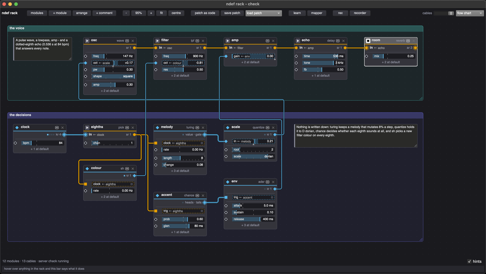

# NdefRack

**A node-based patch window for Ndefs, where every Ndef is a module and every
cable is a JITLib mapping.** A SuperCollider extension.

Define an Ndef and it is in the rack, with an input port and a control for each
of its controls. Map one Ndef into another and there is a cable. Drag a cable in the
window and it is `Ndef(\dst).set(\input, Ndef(\src))`. There is no module
definition to write and no patch stored anywhere but in the Ndefs themselves.

```supercollider
s.boot;
NdefRack.gui;

Ndef(\osc, NdefRackLib(\verbos));     // a harmonic oscillator, from the library
Ndef(\lfo, NdefRackLib(\lfo8));       // eight phases of one lfo
Ndef(\osc).set(\levels, Ndef(\lfo));  // a cable: eight channels into eight levels
NdefRack.play(\osc);
```



The generative example (`patches/06 generative.scd`, in the window's **load
patch** menu): a voice on the top row, left to right in the order the sound
goes, and under it the modules that decide what it plays - each part in a
network box with a comment saying what it does.

It depends on nothing but JITLib, which comes with SuperCollider. Three of the
library's filters are written for **sc3-plugins** UGens; without sc3-plugins
they are left out of the library and everything else works. If
**JITLibExtensions** is installed, specs added with `Ndef(\x).addSpec` are read
too, with **BusManager** (my sc-bus-manager) the library's `bus` module reads
its buses by name as well as by index and `send` and the other **buses** modules
write to them, with **BusRecorder** (my sc-recorder) any
audio module can be recorded - see [Recording](#recording) - and with the
**Modality toolkit** a controller can turn the controls - through **Mapper**
(my sc-mapper) when it is installed - see [Controllers](#controllers).

Written for SuperCollider 3.13 on macOS. Nothing in it is platform specific
apart from the symlink in `install.scd`, which Linux shares and Windows does not.

## Install

### As a quark

```supercollider
Quarks.install("https://github.com/fracnesco/Ndef-rack.git");
thisProcess.recompile;
```

`Quarks.install` clones the repository into your `downloaded-quarks` folder and
puts it on the class path; the recompile is what makes the classes exist, and is
the same thing as `Language -> Recompile Class Library` (ctrl/cmd + shift + L).

Afterwards:

```supercollider
Quarks.update("Ndef-rack");      // pull the newest version, then recompile
Quarks.uninstall("Ndef-rack");   // take it off the class path
```

The quark goes by the name of the repository, `Ndef-rack`; the class inside it
is `NdefRack`.

### From a clone

If you would rather have a working copy you can edit, clone it wherever you keep
things and link it into the extensions folder:

```sh
git clone https://github.com/fracnesco/Ndef-rack.git "Ndef rack"
```

There is an `install.scd` in the repository that does the linking for you: open
it and evaluate the first block, then recompile the class library. It symlinks
the folder into `Platform.userExtensionDir` as `NdefRack` and tells you what it
did.

On Windows there is no `ln -s`, so use the quark, or copy the folder into the
extensions folder by hand - `Platform.userExtensionDir.openOS` opens it.

Install it one way or the other, **not both**: two copies on the class path is a
duplicate class error at compile time.

### Check that it took

```supercollider
NdefRackLib.keys;    // the modules that came with it
NdefRack.gui;        // the window
```

Select `NdefRack` and press cmd/ctrl + d for the help file: it has a walkthrough
you can evaluate a block at a time.

## Every Ndef is a module

The rack watches `Ndef.dictFor(s)`. An Ndef defined in code turns up in the
window within a quarter of a second; a new source, a new control, a `set` from a
routine reaches the module straight away, because each module is a dependant of
its Ndef. Nothing about a module is written anywhere else:

- **the title** is the Ndef's name;
- **every control** is a row: an input port on the left edge, then a bar with
  its name, the control and its value - everything in `controlNames` except
  `out`, `i_out`, `gate` and `fadeTime`:
  - a control rate control gets a **bar** - a fill, a notch at the default and
    the value in its units, `1.2 kHz`, `+0.25 oct`, `10 ms`; with whole steps a
    tick per step, and with 0 or 1 a **switch**,
  - an array control, `\levels.kr(0 ! 8)`, gets **a bar per value** to draw,
  - an audio rate control, `\in.ar(0)`, gets **a port only**,
  - a trigger control, `\t_reset` or `.tr`, gets **a button** that fires,
  - a control called `trig`, `gt`, `hold` or `clock`, or whose spec's units are
    `"gate"`, gets **a button** that is 1 while you hold it;
- **the output** is the Ndef's bus - one port on the right edge, carrying every
  channel, labelled with its rate and width: `ar 1`, `kr 8`.

The rows come in the same order on every module: the main inputs (`in`), then
timing (gates, `rate`, triggers), then the rest, then the output range and the
level (`lo`, `hi`, `mix`, `level`, `amp`). The main input sits on one line with
the output, so a chain placed left to right wires straight across.

```supercollider
Ndef(\mine, {
	var sig = Saw.ar(\freq.kr(110, spec: [40, 400, \exp]) * [1, 1.01]);
	RLPF.ar(sig, \cutoff.kr(1200), \rq.kr(0.3)) * \amp.kr(0.1)
});
```

That Ndef is a module with four bars - `freq`, `cutoff`, `rq`, `amp` - and a
stereo output, `ar 2`.

### Where the ranges come from

The rack never asks you for a spec. It looks, in this order:

1. the Ndef's own: `spec:` in the function, `\freq.kr(110, spec: [40, 400,
   \exp])` - and, when JITLibExtensions is installed, `Ndef(\x).addSpec(...)`,
   which takes precedence the way it does there;
2. the name in the global table, `\freq.asSpec` - but only when the control's
   default fits inside it, so an lfo's `\freq.kr(0.5)` is not given a 20 Hz floor;
3. a guess from the name and the default: `cutoff` with 1200 is a frequency,
   `depth` with 0.3 is 0 to 1, `attack` with 0.01 is a time.

```supercollider
NdefRackSpec.for(Ndef(\mine), \cutoff);     // the spec the bar uses
NdefRackSpec.origin(Ndef(\mine), \cutoff);  // -> \guess
```

A spec only sets where a bar can reach. A value set in code outside it stays
what it is; the bar sits at its end and the number says the truth.

## Every cable is a mapping

Drag from a module's output to another module's input and the rack runs

```supercollider
Ndef(\dst).set(\input, Ndef(\src));
```

which is all a cable is. It works across rates - control into audio, audio into
control - and a wide source fills an array: an 8-channel Ndef into an 8-value
control sets all eight. Into a single control, only the first channel lands; the
controls next to it are not touched.

```supercollider
NdefRack.connect(\lfo, \osc, \levels);   // the same, from code
NdefRack.disconnect(\osc, \levels);
NdefRack.unplug(\osc);                   // every cable in and out
NdefRack.cables;                         // (from: \lfo, to: \osc, param: \levels, kind: \map) ...
```

Unplugging is the one thing this extension has to get right. It is
`Ndef(\dst).unmap(\input)` - **not** `unset` - and then the control's value set
again: the value it had before the cable arrived, or the default for a cable
that was made in code. `unset` alone leaves the server reading the bus, because
it sends back what the node map holds for the key, and for a patched input that
is the source Ndef.

Because the patch is read from each Ndef's node map, a cable made in code is the
same thing as a cable dragged in the window, and shows as one:

```supercollider
Ndef(\osc).set(\fm, Ndef(\wave));     // a cable, in the window at once
Ndef(\fx) <<>.in Ndef(\osc);         // so is this
```

An Ndef read inside another one's source function, `Ndef.ar(\osc)`, is drawn as
a thin dashed line into the left edge of that module's title. It cannot be unplugged from the
window - it is in the function.

### A cable replaces the value

Mapping puts the source's signal into the control in place of its value;
it does not add to it. An lfo of -1..1 into a cutoff of 1200 is a cutoff of
-1..1 Hz. The library deals with this in two ways:

- its modulators have **lo** and **hi**: the range they swing over, in whatever
  units the input wants;
- its oscillators and filters have **inputs that add**: `oct` adds octaves to
  `freq`, `oct` moves a cutoff in octaves, `fm` modulates a frequency - so an lfo
  of -1..1 into `oct` sweeps an octave either way of wherever the cutoff is set.

`tofreq` and `rescale` in the utilities put any modulator into any range.

## Voices

The library modules marked *voices* below can play several at once - right click
one, **voices**, or:

```supercollider
NdefRack.make(\chord, \ch, 4);          // a chord: a pitch per voice
NdefRack.make(\wave, \pad, 4);           // four oscillators in one module
NdefRack.make(\splay, \out);            // voices onto a stereo pair
NdefRack.connect(\ch, \pad, \oct);     // voice to voice
NdefRack.connect(\pad, \out, \in);      // splay takes the cable's four voices
NdefRack.play(\out);
[\ch, \pad].do { |k| NdefRack.setVoices(k, 6) };   // six now - all still patched
```

A module with four voices is four copies of itself in one Ndef: a channel per
voice out, one bar setting every voice. A cable with four voices into a module
with four goes voice to voice; a mono cable reaches every voice - the rack maps
it `Ndef(\lfo) ! 4`; a cable with voices into a mono input brings only the first,
so voices end at `splay` or `sum`, which take as many as their cable brings.
Changing the number keeps every cable patched without a gap; it restarts the
module, and what it feeds, the way a new source would.

## The window

`NdefRack.gui`.

```
 ndef rack [+ module] [arrange] [+ comment]   [-] [100%] [+] [fit] [centre]   [patch as code] [save patch] [load patch v]   [learn] [mapper]   cables === [flow chart v]
 +------------------+      +--------------------------+      +------------------------+
 |<> lfo   lfo8  [x]|      |[>] osc    verbos    [x]  |      |[>] flt     lpf    [x]  |
 |      ..... kr 8 <>--.   o in              ar 1     o------o in  ← osc    ar 1      o
 |<> [rate 0.20 Hz] |  |   |<> [freq      110 Hz]     |      |<> [freq   1.2 kHz]     |
 +------------------+  '---<> levels ← lfo            |      +------------------------+
                           |   ▌▌▌▌▌▌▌▌               |
                           +--------------------------+
 9 modules · 6 cables · server localhost running · 2 selected              [x] hints
 freq 110 Hz: drag left and right (shift for fine), click the value to type one, double click for 110 Hz, range 20 Hz to 20 kHz
```

- **title** - click it, or the empty face of a module, to select the module;
  drag it to move it. A module playing voices says how many: `pad ×4`. The play
  button on an audio rate module plays it (a mono module on both sides, voices
  spread across the pair) and stops it; the **x** deletes it.
- **bar** - drag left and right, from where the value is: the bar's width is
  the whole range; shift for ten times finer. Click the value to type one;
  double click resets it to the function's default. While its input is patched
  it takes no drag, and shows what the cable brings in - a line at the value
  now, a band over the last two seconds, and a small triangle at the value it
  goes back to when unplugged.
- **switch** - click to flip it.
- **array** - click and drag across the bars.
- **button** - a trigger fires on press; a gate is 1 while held.
- **ports** - drag from the output (the right half of the main row)
  to an input's row, or to a module's title for its first free main input; or
  from an input to any other module. Or click once, let go, and click the
  target: the cable follows the mouse in between. A plugged input can be picked
  up: drop it on another row to move the cable, on the empty rack to unplug it.
  While a cable is loose, the hint bar says what letting go would do, and
  escape lets it go.
- **right click** (or control-click) a module for its voices, copy, cut,
  duplicate, delete, play, its code in a document, unplug every cable, open it in
  NdefGui, open its library file; a control for reset, type a value, unplug, and
  the line of code that sets it. Right click the empty rack to add a library
  module right there, or to paste there.
- **cables** run behind the modules, orange for audio and blue for control;
  the selected module's are drawn on top. Those with more than one channel -
  voices, stereo - are drawn twice as wide. Right click one on the empty rack
  to unplug it. Rest the mouse on one for half a second and a small picture of what it
  carries opens beside it: a row per voice or channel - the wave of an audio
  cable, the last two seconds of a control one - with its level. Moving the
  mouse puts it away.
- **arrange** lays the modules out left to right, the way the signal flows,
  with as few cables crossing as it can; modules with no cables go in a row
  underneath. With modules selected it arranges only them - the main
  audio path on a row, a row under it for each other part; key **a** does the
  same. A new module is placed the same way: beside what it is cabled to, or, cabled to nothing, in the first free spot in
  view.
- **rec** and **recorder**, with BusRecorder installed: start and stop a take,
  and open BusRecorder's window - see [Recording](#recording).
- **+ comment** puts a box of text on the rack - double click it to write,
  drag it to move, its corner to resize; it is saved with the patch.
- **compact**: the small button left of a module's x shows only the controls
  set away from their defaults or patched, and "+ n at default" for the rest.
- **pages**: a module with more than eight controls past its main inputs shows
  them on pages, tabs under its main row.
- **network boxes**: cmd-g puts a coloured box round the selection, behind
  everything; drag its title to move it and all that is in it.
- **colours**: right click a module, a cable or a box for **colour**. A module
  gets a coloured edge and a tinted title, a cable coloured stripes - both keep
  the orange or blue of audio or control.
- **-**, **+**, **fit**, **centre**: zoom out and in (cmd-minus, cmd-plus, or
  cmd and the wheel; a click on the zoom is 100%), everything in view (**f**),
  back to the middle of the patch (**h**).
- **cables** sets how strongly the cables are drawn; the menu beside it draws
  them as a **flow chart** - straight runs at right angles round the modules,
  the default - as **curves**, or as **straight** lines. In the flow chart, click
  a cable to select it and drag it to move where it bends; backspace unplugs
  it.
- **hints** folds the hint bar away: the line along the bottom that says what
  the mouse is over - a control, its range, where a cable comes from - what a
  loose cable would do, and what the last copy, paste or delete did.

A control rate module's output is read from the server's shared memory thirty
times a second: the lights by its output show its channels, and every bar
it is patched into shows the value arriving - a line per voice. That needs a local server; an audio
rate cable shows where it comes from but not its value.

Opening the window starts the watching; closing it stops it again, unless you
had started it yourself with `NdefRack.watch`.

### Selecting, copying, deleting

Click a module's title to select it; shift-click adds another, or takes it out
again; a drag on the empty rack draws a band and selects what it touches, with
shift adding to what was selected. Drag any selected module and they all move.

| keys | what |
|------|------|
| cmd-c | copy the selection |
| cmd-x | cut it: copy, then delete |
| cmd-v | paste where the mouse is |
| cmd-d | duplicate it, leaving the clipboard alone |
| backspace, delete | delete it |
| cmd-z | undo the last thing done in the window - a move, an arrange, a cable, a value, a delete |
| cmd-shift-z | do it again |
| cmd-a | select every module |
| escape | select nothing |

A copy is a new Ndef with the same source, slot by slot, and the values its
controls show, named after the original - `osc` pastes as `osc_2`, then `osc_3`.
**The cables between the copied modules come along, wired between the copies;
a cable from or to a module outside the copy stays behind**, and the input it
fed gets back the value it had. Nothing pasted plays until you play it.

Deleting is `NdefRack.remove`: the module's cables are unplugged, the Ndef is
cleared and its name forgotten. Everything about it is written down first, so
cmd-z brings back the last delete as it was - names, values, places, every
cable including those to modules still in the rack, and playing if it was. It
undoes every other step taken in the window the same way, one at a time: a drag,
an arrange, a cable, a value, a module made, a box or a comment; cmd-shift-z does
it again. What your code or a controller changes is not a step and stays as it is.

```supercollider
NdefRack.copy([\lfo, \osc]);       // the same from code
NdefRack.paste(Point(400, 300));   // -> [\lfo_2, \osc_2], the top left of the group there
NdefRack.duplicate([\osc]);
NdefRack.removeAll([\lfo_2, \osc_2]);
NdefRack.undoRemove;
```

## The library

A library module is an Ndef source function in a plain file in `modules/`, one
per file, named after its key. Nothing in them needs compiling, and every one is
there to be read and copied.

```supercollider
Ndef(\tm, NdefRackLib(\turing));     // the function itself
NdefRack.make(\turing);              // the same, under the next free name
NdefRackLib.help(\turing);       // one line
NdefRackLib.postHelp(\turing);   // what it does, and every control
NdefRackLib.openFile(\turing);
```

*voices* marks a module that can play several at once - see [Voices](#voices).

| module | what it is |
|--------|------------|
| **oscillators** | |
| `verbos` | after the Verbos Harmonic Oscillator: eight sine partials with a level each (an array), a window scanned across them, odd and even balance |
| `wave` | sine, triangle, saw and square morphed by one control; pulse width, oct and FM inputs; *voices*, with a detune |
| `fm2` | two operators: a modulator with feedback bending a carrier's phase |
| `pluck` | a Karplus-Strong string, plucked by a gate or its own clock |
| `noise` | white, pink and brown, one control between them |
| `pulsar` | pulsar synthesis: a windowed burst at a formant, fired at the fundamental - a rhythm below 20 Hz, a pitch above; pulses masked in turn or by chance; *voices* |
| **modulation** | |
| `lfo8` | one lfo eight times, spread around the cycle; 0..1 to start, for arrays of levels |
| `lfo` | sine, triangle, saw, square and stepped random, morphed; lo..hi; *voices*, spread around the cycle |
| `walk` | a random walk: small steps, never far from where it was |
| `adsr` | an ADSR envelope while a gate is held; *voices* |
| `sh` | sample and hold; samples its own noise until you turn it down |
| `slew` | a slew limiter, rise and fall separate |
| `macro` | a control that is a signal, to patch into many inputs at once |
| `mouse` | the mouse position, two channels |
| `ramp` | after the Befaco Rampage and Maths: a function generator - rise, fall, held while the gate is on, cycling, shaped log to exp; an end-of-cycle trigger |
| **sequencing** | |
| `turing` | after the Turing Machine: a circular memory of 2 to 16 bits, each flipped by chance on its way round; value and gate |
| `seq8` | eight steps of values and gates, both multisliders; value and gate |
| `clock` | beats, eighths, sixteenths and bars, as gates |
| `euclid` | an euclidean rhythm: pulses spread as evenly as they go into steps |
| `chance` | a Bernoulli gate: heads to channel 1, tails to channel 2 |
| `quantize` | a pitch in octaves held to a scale |
| `chord` | a chord from a root in octaves, a pitch per voice; *voices* |
| `burst` | after the Befaco Burst: one gate in, a burst of gates out - count, time apart, speeding up or slowing down, each by chance |
| `grid` | after Mutable's Grids: a drum pattern map - x, y pick a place among nine patterns; kick, snare and hat densities; chaos; three channels of gates |
| **filters** | |
| `lpf` `hpf` | resonant 2-pole lowpass and highpass; *voices* |
| `bpf` `notch` | bandpass and band stop; `bpf` *voices* |
| `ladder` | a Moog-style 4-pole lowpass, MoogFF; *voices* |
| `multimode` | lowpass, bandpass, highpass, one control between them; *voices* |
| `formant` | three formants of a voice, morphed a e i o u |
| `comb` | a comb filter tuned to a pitch |
| `resonator` | eight modes that ring when struck, harmonic to bell-like |
| `strings` | after Rings' sympathetic strings: five strings tuned to each other - unison, octaves, fifths, a chord - ringing with the input or a strike |
| `dfm1` `moogladder` `svf` | sc3-plugins' DFM1, MoogLadder and SVF, when sc3-plugins is installed |
| **mixers** | |
| `amp` | an envelope into gain shapes the sound; *voices* |
| `splay` | the voices of a cable spread across a stereo pair; as many as the cable brings |
| `sum` | the voices of a cable added into one signal; as many as the cable brings |
| `mixer` | four mono inputs into a stereo pair, levels and pans as arrays |
| `pan` | a mono input into a stereo pair |
| `xfade` | equal-power crossfade from a to b |
| **effects** | |
| `delay` | an echo with a lowpass in its feedback, up to 2 s |
| `reverb` | FreeVerb, stereo; a mono cable feeds both sides |
| `phaser` | four allpass stages swept by an lfo of their own |
| `fold` | a wavefolder |
| `crush` | fewer samples, fewer bits |
| `freqshift` | every partial moved by the same number of hertz |
| `ring` | ring modulation by its own sine or anything patched in |
| `grains` | after Mutable's Clouds: the last two seconds cut into grains - position, size, density, pitch, spread; freeze, feedback |
| `plate` | after Valley's Plateau: a Dattorro plate reverb with a size, a decay up to for ever, damping, modulation |
| `crossmod` | after Mutable's Warps: two inputs crossfaded, ring modulated, folded, xor-ed or compared, one control morphing between |
| **drums** | |
| `kick` | a sine falling onto its note: punch, sweep, decay, drive |
| `snare` | two tuned sines and a burst of noise, mixed by tone |
| `hat` | six square waves through a highpass: short for closed, long for open |
| **spat** | |
| `vbap` | a mono input among the speakers of a setup, between the nearest two or three: azi, ele, spread (needs sc3-plugins) |
| `ambi` | the same among all of them, the same size everywhere (ambisonics): azi, ele, focus |
| **utilities** | |
| `pick` | one channel out of a wide cable |
| `rescale` | one range into another, linearly |
| `tofreq` | a modulator onto a frequency, exponentially |
| `hz` | octaves to hertz, for an Ndef of yours that only takes a frequency |
| `modmix` | four control signals summed, each with its own gain |
| `values` | a value per voice from a slider each - a setting of its own for every voice; *voices* |
| `input` | one input of the sound card: a microphone or an instrument, to play or to listen to |
| **buses** | |
| `bus` | a bus: one of BusManager's by name - at its rate and width, following the name when the bus moves - or an index of your own, at the width and rate you give it; picked in a drop-down on its face |
| `send` | a send: in added to a bus, times level, and passed on untouched |
| `throw` | a send with a gate on it: open only while the button, or a gate, is on - attack, release |
| `sendpan` | a mono send placed across the bus's channels: pos from the first to the last, width past two |
| `replace` | what is on a bus replaced by in |
| `blend` | a crossfade between what is on a bus and in: mix |
| `insert` | an insert point on an audio bus: its output is what is on the bus, what comes back at in takes its place, by mix |
| **listening** | |
| `follower` | how loud the input is, floor..top dB scaled to lo..hi; and a gate while above a threshold |
| `pitch` | the pitch it hears, in octaves from ref - into a wave's oct, the wave plays it; and a gate while a pitch is heard |
| `onsets` | a gate for every note or hit it hears start; and how loud it was |
| `brightness` | the spectral centroid, dark..bright Hz scaled to lo..hi |
| `noisiness` | the spectral flatness, scaled to lo..hi: a sine about 0, white noise about 0.85 |
| `beat` | a beat tracker: gates on the beat, eighths and sixteenths, like `clock`, and the tempo in bpm |
| `bands` | eight bands an octave apart, a level each - into `verbos`' levels |
| **analysis** | |
| `scope` | an oscilloscope drawn in the module: two traces, triggered on a rising zero crossing; time and gain |
| `spectrum` | a spectrum analyser drawn in the module: log frequency, dB down to floor |

`scope` and `spectrum` pass their input on from their output unchanged, so they
can sit in the middle of a chain. The picture is the window's, not the Ndef's:
the window runs a small synth of its own that reads the module's bus, and the
controls on the module set the picture without touching the sound. They need a
running server; the picture is read over OSC, so a remote one works too, only
slower.

The **listening** modules turn a sound into control signals: how loud it is,
its pitch, its attacks, how bright or noisy it is, its beat. Each hears one
signal - a cable with voices brings the first - and those that measure what a
sound is like - pitch, brightness, noisiness - hold their last value through a
silence. `input` brings a microphone in:

```supercollider
NdefRack.make(\input, \mic);
NdefRack.make(\pitch, \ears);
NdefRack.make(\wave, \echo);
NdefRack.connect(\mic, \ears, \in);
NdefRack.connect(\ears, \echo, \oct);    // the wave plays the note it hears
NdefRack.play(\echo);                    // with headphones: the mic hears the speakers too
```

**`bus`** reads a bus, so whatever else in the session writes there comes into
the rack: one of BusManager's buses by its name - an audio bus at audio rate, a
control bus at control rate, as many channels as it has - or a bus index of your
own, at the width and rate you give it:

```supercollider
BusManager.add(\drums, 2);                // a stereo bus with a name
NdefRack.make(\bus, bus: \drums);         // Ndef(\drums): what is on it
NdefRack.make(\bus, bus: \in1_2);         // Ndef(\in1_2): the sound card's first two inputs
NdefRack.make(\bus, \fx, bus: 16, channels: 2);   // Ndef(\fx): audio buses 16 and 17
```

In the window, a bus module has a drop-down under its title: BusManager's buses,
then **a bus index...** to type one in, and for an index its **channels** and
**rate** - `NdefRack.setBus(\drums, \other)` or `NdefRack.setBus(\fx, 20)` from
code, the module keeping its name. A BusManager bus is followed by its name, the
way BusManager's other modules do: when the bus moves - a reboot, a layout
loaded, the name added again at another width - the module moves with it, and
stays patched. A bus taken away leaves it reading where it was. An index of your
own stays where it is; the module needs no BusManager for it.

The other **buses** modules write to a bus, picked the same way: **`send`**
adds what comes in at `in` to the bus and passes it on at its output, so it sits
on the way - **`throw`** only while its gate is open, **`sendpan`** a mono
signal placed across the bus's channels. **`replace`**, **`blend`** and
**`insert`** change what is already on the bus.

```supercollider
BusManager.add(\verb, 2);                  // the reverb's bus
NdefRack.make(\wave, \osc);
NdefRack.make(\send, bus: \verb);          // Ndef(\send), writing to BusManager's \verb
NdefRack.connect(\osc, \send, \in);        // osc is on the bus - a mono cable on both sides
NdefRack.make(\bus, \back, bus: \verb);    // and read back, for a reverb module
```

A send sends whether or not its module plays: the play button and the volume
are its own output, `level` is the send. `replace`, `blend` and `insert` act
only on what modules made before them have written to the bus - the rack never
reorders anything - so make them last.

The conventions they share:

- **audio** is mono, from oscillator to filter to amp; stereo arrives at
  `mixer`, `pan` and `reverb`.
- **pitch** is in octaves at `oct`, added to `freq`, so 1 is an octave up; the
  sequencers put out 0..1, one octave, until you widen lo and hi.
- **gates** are kr signals, on above 0.5; a clock input steps on its rising edge.
- **a wide cable** carries all of its Ndef's channels. `turing`, `seq8` and
  `chance` put their main signal on channel 1, where a single input reads it;
  `pick` takes out any other channel - the gate, the eighths.
- **voices** are mono, a channel per voice, until `splay` or `sum` brings them
  together.
- **listening** takes audio at `in` and puts out control signals: a measure
  scaled to lo..hi, a pitch in octaves, gates on what it hears; levels are in
  dB, and below `floor` nothing counts.

### Modules of your own

Write files of the same shape and add the folder:

```supercollider
// ~/my-modules/drone.scd
(
	category: \oscillators,
	help: "three detuned saws",
	func: { Saw.ar(\freq.kr(55, spec: \freq) * [1, 1.003, 0.997]).sum * \amp.kr(0.1, spec: \amp) }
)
```

```supercollider
NdefRackLib.addFolder("~/my-modules");
NdefRack.make(\drone);
```

or add one from code: `NdefRackLib.add(\drone, { ... }, \oscillators, "three
detuned saws")`. A file whose module needs UGens that are not core says so on a
line of its own, `// requires: DFM1`, and is left out quietly where the class is
missing. `NdefRackLib.reload` reads the folders again after an edit; an Ndef
already running keeps its old function until you set it again.

Any Ndef is a module whether it came from the library or not - the library is
there to start from, not to go through.

## Speakers

**`vbap`** and **`ambi`** place a mono sound among loudspeakers. Each pans
across a **speaker setup** - stereo, quad, 5.1, 7.1, a ring of eight, a cube, a
dome, sixteen that come with the rack and any of your own - and puts out a
channel per speaker, in the setup's order:

```supercollider
NdefRack.make(\vbap, \pan, speakers: \octo);  // eight speakers in a ring
NdefRack.connect(\osc, \pan, \in);
NdefRack.make(\ramp, \round);                 // anything from -1 to 1 into azi goes once round
NdefRack.connect(\round, \pan, \azi);
NdefRack.setSpeakers(\pan, '5.1');             // other speakers: everything patched is kept
NdefRack.play(\pan);                          // speaker 1 on output 1, 2 on 2 ...

NdefRackSpeakers.names;                       // the setups
NdefRackSpeakers.add(\studio, [[-30, 0], [30, 0], [-110, 0], [110, 0], [0, 60]]);
```

In the window the setup is a drop-down under the module's title. `azi` is 0
straight ahead, 0.5 to the right, -0.5 to the left, 1 and -1 behind; `ele` is
the height. `vbap` gives the sound to the nearest speakers only - sharp, and
right for any room; `ambi` gives every speaker a share, so the sound keeps its
size as it moves, with `focus` from wide to sharp. They have the same controls
otherwise, and the same level. Played, a module with more than two speakers
goes to as many outputs when the server has them, and is folded onto the stereo
pair when it has not. The `NdefRackSpeakers` help file has the table of setups.

## Recording

With **BusRecorder** installed, any audio module can be recorded: right click
it, **record**, and it is one of BusRecorder's sources - its Ndef's bus, under
the module's name - with a red dot by its play button. **rec** in the toolbar
records a take of every armed source, the rack's and any others you gave
BusRecorder; the status line shows how long it has been going.

```supercollider
NdefRack.setRecorded(\pad);            // a source of the next take
BusRecorder.mode = \sources;            // one file per source: rack_001_pad.wav ...
BusRecorder.record;
BusRecorder.stop;
NdefRack.setRecorded(\pad, false);
```

Where the files go, how a take is split into them and what they are called is
BusRecorder's business - its window, from **recorder**. The rack keeps no list:
a module is recorded while BusRecorder has a source reading its bus. When the
module changes width - its voices - the source moves to its new bus, even in
the middle of a take (whose files keep the width they started with). Deleting
the module takes its source away; cmd-z brings both back.

## Controllers

With the **Modality toolkit** installed, a controller turns the rack's
controls. Any MKtl will do; the examples are an Akai Midimix.

```supercollider
MKtl(\m1, "akai-midimix");
NdefRackKtl.follow(\m1);                    // the knobs turn the selected module, top to bottom
NdefRackKtl.bind(\m1, \sl_1, \pad, \amp);   // a fader always on pad's amp
```

**learn** in the toolbar works the other way round: click a control, gate or
trigger, move something on the controller, and that is what turns it. A moved
element is an `Ndef(...).set` like any other, so the bar in the window follows
it and saving keeps the value; the controller's knobs pick up where the control
is rather than jumping. Patch files keep the bindings. `NdefRackKtlSim(\m1).gui` is a Midimix
on the screen for when the real one is not plugged in - it sends the MIDI the
controller would, through Modality's own device. The
`NdefRackKtl` help file has the rest.

With **Mapper** (my sc-mapper) installed the rack is one of its providers:
**learn** is Mapper's learn mode, and **mapper** in the toolbar opens its window,
where every control of the rack is a target, `[\ndef, \lp, \freq]`. Mapper keeps
those mappings in its own file.

```supercollider
Mapper.default.map(\m1, \kn_1_1, [\ndef, \lp, \freq]);
```

## The patch as code

**patch as code**, or `NdefRack.patchDocument`, opens a new, empty document in
the IDE with the rack written in it as code you can keep - and so do a module's
"as code" and a control's "the set line as code". `NdefRack.postPatch` writes
the same to the post window, and without an IDE the document is posted instead.

```supercollider
(
// ndef rack, 2026-10-16 15:41
Ndef(\lfo, NdefRackLib(\lfo8));
Ndef(\osc, NdefRackLib(\verbos));
// Ndef(\pad) - your own code

Ndef(\lfo).set(\rate, 0.2);
Ndef(\osc).set(\levels, Ndef(\lfo), \scan, 0.4, \width, 0.2);
Ndef(\pad).set(\in, Ndef(\osc));

Ndef(\osc).play(numChannels: 2);
)
```

Library modules come back from the library - one with voices through
`NdefRack.make(\wave, \pad, 4)`, which gives it its width in any session; your
own Ndefs are named, not copied - their source is your code. Every module's line holds what its node map
holds: the numbers you set and a `Ndef(...)` for each cable. A control you never
touched is not written - its value is the default in the function - and neither
is one you reset or unplugged back to its default. What plays gets a line that
plays it where it is heard now: a mono module the rack plays on both sides is
`.play(numChannels: 2)`.

The library modules are made before any cable is set, and that order matters
for your own Ndefs too: an Ndef that is mapped somewhere before it has a source
becomes a one channel control rate Ndef, and stays one when you give it an
audio source afterwards. Define your own Ndefs before you evaluate a patch.

## Patches

The rack, saved to a file and loaded back: which modules, their settings, the
cables, where each module sat in the window, what was playing. Yours live in the
`patches-local/` folder next to the class files, wherever the extension ended
up. A bare name goes there and gets an `.scd` extension; a path with a slash in
it is used as given, which is the way to keep a patch with a piece rather than
with the extension.

```supercollider
NdefRack.savePatch("tonight");       // -> <extension>/patches-local/tonight.scd
NdefRack.loadPatch("tonight");
NdefRack.loadPatch("tonight", clear: true);   // and remove what the patch does not have
NdefRack.patches;                    // what the window's menu offers
NdefRack.loadPatch("02 fm");         // an example
```

A patch file is one Event, read back with `.load`. Library modules are made when
they are missing. An Ndef of your own written in the interpreter keeps the text
of its function, so the patch can bring it back - but only when nothing defines
it at the time you load; while it exists, your code is the source and the patch
only sets it. Loading never happens by itself.

`patches-local/` is ignored by git, so updating the extension does not touch
your patches. A bare name is looked for there first, then among the examples.

### The examples

`patches/` holds ten example patches, one technique each; the window's
**load patch** menu lists them after your own, as "example: ...". Each loads
with network boxes and a comment per part saying what it does, and plays. An
example takes the place of what is in the rack - cmd-z brings that back - so
loading one after another shows each as it was saved.

| patch | what it shows |
|---|---|
| `01 subtractive` | a saw-to-square wave through a resonant ladder filter, an envelope sweeping the cutoff, a step sequencer and a euclidean rhythm on one clock |
| `02 fm` | two-operator FM: the envelope sweeps the modulation index, an lfo the modulator's feedback |
| `03 physical modelling` | `strings` and a Karplus-Strong `pluck`, played by a mutating `turing` melody held to a scale |
| `04 additive` | `verbos`' eight harmonics, their levels moved by `lfo8`, four voices from `chord` |
| `05 pulsar` | pulsar synthesis swept from a rhythm (6 Hz) into a pitch, a wandering formant, a grain cloud |
| `06 generative` | nothing written down: `turing`, `quantize`, `chance` and sample and hold decide every note, with a dotted echo |
| `07 drum machine` | euclidean rhythms over 16 steps on the synthesized kick, snare and hats |
| `08 feedback delay` | a delay whose feedback runs outside it, through a wavefolder and a highpass |
| `09 ring and shift` | cross modulation through five algorithms, then a frequency shifter |
| `10 listening` | machine listening: a pitch tracker and an onset detector make a second voice follow a plucked melody |

Save over one by name and the copy goes in `patches-local/`; the example stays
as it was.

## Server restarts and cmd + period

The rack keeps nothing on the server. The Ndefs do, as they always do; the rack
reads them. The watching and the window are SkipJacks, so cmd + period does not
stop them, and an Ndef defined before the server boots is a module already -
JITLib sends it when the server is there.

## Files

| file | what it holds |
|------|---------------|
| [classes/NdefRack.sc](classes/NdefRack.sc) | the rack: watching, modules, cables, connect and disconnect, voices, the code export, patches |
| [classes/NdefRackModule.sc](classes/NdefRackModule.sc) | one Ndef as the rack sees it: its controls, values, cables, voices |
| [classes/NdefRackSpec.sc](classes/NdefRackSpec.sc) | where a control's range comes from, and its value in words |
| [classes/NdefRackLib.sc](classes/NdefRackLib.sc) | the module library: loads `modules/`, finds a module by name, makes it for a number of voices |
| [classes/NdefRackSpeakers.sc](classes/NdefRackSpeakers.sc) | the speaker setups vbap and ambi pan among, and the numbers that do it |
| [classes/NdefRackGUI.sc](classes/NdefRackGUI.sc) | the window: the rack, the cables, the toolbar, selection, the keys |
| [classes/NdefRackModuleView.sc](classes/NdefRackModuleView.sc) | one module in the window: ports, bars, switches, buttons, arrays, a display |
| [classes/NdefRackDisplay.sc](classes/NdefRackDisplay.sc) | the picture in a scope or a spectrum module |
| [classes/NdefRackBrowser.sc](classes/NdefRackBrowser.sc) | the panel down the left of the window: every module in the library, searched and sorted, made by a double click or a drag |
| [classes/NdefRackHintBar.sc](classes/NdefRackHintBar.sc) | the line along the bottom that says what the mouse is over |
| [classes/NdefRackLayout.sc](classes/NdefRackLayout.sc) | where modules go: new ones beside what they are cabled to, and arrange |
| [classes/NdefRackCommentView.sc](classes/NdefRackCommentView.sc) | a comment: a box of text on the rack |
| [classes/NdefRackRouter.sc](classes/NdefRackRouter.sc) | cables as a flow chart: straight runs at right angles round the modules, and where they bend |
| [classes/NdefRackUndo.sc](classes/NdefRackUndo.sc) | cmd-z and cmd-shift-z: each step taken in the window, undone and done again |
| [classes/NdefRackKtl.sc](classes/NdefRackKtl.sc) | a Modality controller on the rack: bind, learn, follow, picking up |
| [classes/NdefRackMapper.sc](classes/NdefRackMapper.sc) | the rack's controls as Mapper's targets, `[\ndef, module, control]`, and the window's learn through Mapper |
| [classes/NdefRackKtlSim.sc](classes/NdefRackKtlSim.sc) | a MIDI controller that is not plugged in, sending through Modality's own device |
| [modules/](modules/) | the library, one module per `.scd` file |
| [HelpSource/Classes/](HelpSource/Classes/) | the help files, cmd/ctrl + d on a class name |
| [install.scd](install.scd) | symlinks the repository into the extensions folder |
| [Ndef-rack.quark](Ndef-rack.quark) | the quark manifest, named after the repository so `Quarks` can find it |

## More

The help files go further than this page: `NdefRack` for the rack and its
patching, `NdefRackGUI` and `NdefRackModuleView` for every gesture in the window,
`NdefRackLib` for writing modules (and displays) of your own, `NdefRackLayout`
for how a network is laid out.

## Issues

Bug reports and questions are welcome in
[Issues](https://github.com/fracnesco/Ndef-rack/issues).

## License

MIT - see [LICENSE](LICENSE).
